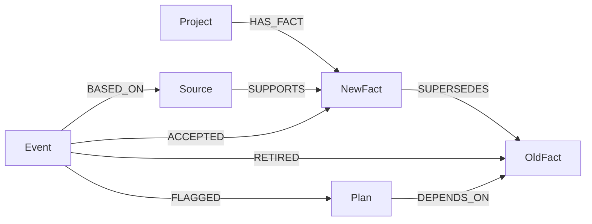
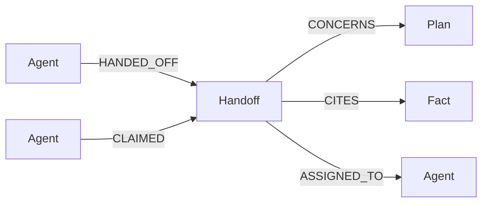

# Retract

Persistent project memory for coding agents. A confirmed, scoped correction
supersedes an outdated fact, keeps its evidence and history, and flags plans
with explicit dependencies on that fact.

Real FalkorDB integration, persistence across database and service restarts,
PostgreSQL account storage, dashboard and settings browser checks, and a real
Codex MCP recall have been verified locally, as has live Groq classification on
the 16-case synthetic set. A fresh coding-client feature-generation run also
passed: real recall, visible plan revision, generated code, 10 contract tests,
and 10 Chromium scenarios. See the [recorded run and evidence](docs/12-FRESH-CLIENT-RUN.md)
and [verification record](docs/06-IMPLEMENTATION-STATUS.md).

The product and remaining milestones are described in [docs/README.md](docs/README.md).

The Phase 5 evaluator and submission draft are also implemented. Run
`python scripts/verify_phase5.py` for a fresh offline evidence bundle, or follow
[the evaluation guide](docs/10-EVALUATION-AND-RELEASE.md) for real graph/model
measurements and demo rehearsal. [SUBMISSION.md](SUBMISSION.md) is a draft;
working-video and public-submission evidence remain pending.

## Graph model

FalkorDB owns accepted facts, their supporting sources, immutable update events,
and explicit plan dependencies. A replacement retains the historical fact and
its evidence. Each endpoint is project-scoped; fact keys additionally include
scope, subject, and predicate.



The graph drives stored dependency discovery and replacement/evidence history.
See the [actual queries and algorithm](docs/11-GRAPH-QUERIES.md), implemented in
[graph.py](src/retract/graph.py). The runtime has no test-store fallback.


## Local setup

Requires Python 3.12+ and Docker with a running daemon. Run from this directory:

```sh
python3 -m venv .venv
source .venv/bin/activate
python -m pip install -e .
docker compose up -d --wait
retract serve
```

The API binds to `127.0.0.1:8100`; FalkorDB binds to `127.0.0.1:6380`. The
database uses a named volume and AOF with `appendfsync always`. The image pin
`falkordb/falkordb:6.0.2` has passed this project's integration suite and restart gate.
Configuration variables are listed in [.env.example](.env.example). Copy it to
`.env` (git-ignored); the `retract` CLI reads it from the working directory, and
exported variables take precedence. Verification scripts read only exported
variables, so run `set -a; source .env; set +a` first. No API key or inference
account is needed for structured updates.

Use one service process per graph. A local file lock prevents accidental second
processes with the same database configuration. All clients send writes through
the API; other processes must not write directly to the graph. Host aliases,
other machines, and distributed writers are outside this MVP's guarantees.

## Run the structured demo

In another terminal with the virtual environment activated:

```sh
retract seed
retract recall account-settings web-client/main
retract call updates fixtures/confirmed-update.json
retract call updates fixtures/proposal.json
retract recall account-settings web-client/main
retract recall account-settings cli-client/main
retract recall account-settings account-service/main
retract history account-settings --fact F1
retract history account-settings --event U1
```

Expected behavior, observed on a real database: F1 becomes superseded, F5 becomes
active, P1 needs review, and F2–F4 remain unchanged. The MongoDB proposal does not
replace PostgreSQL. Calling the confirmed-update command again returns the
original result without repeating its effects. Reusing U1 for a different
request returns a conflict.

## Reviewer agent and handoffs

After a correction, run the reviewer agent:

```sh
retract agent review account-settings web-client/main            # drafts with Groq
retract agent review account-settings web-client/main --template # offline, no model
```

It calls `recall`, follows each flagged plan's `DEPENDS_ON` and `SUPERSEDES`
paths to find which dependencies were replaced, drafts a revised plan that cites
only current facts, and records a `handoff` to the coding agent (`--to-agent`,
default `codex`). It never revises a plan or changes a fact; the coding agent
claims the handoff with `claim_handoff`, confirms the plan with `revise_plan`,
and implements it. Re-running is safe: a plan that already has the same handoff,
open or claimed, is skipped before any model call. A model draft that cites a
retired or unrelated fact is rejected and no handoff is recorded.



`recall` lists open handoffs for a scope; each affected plan also reports its
dependency status and existing handoffs. A claim reports whether cited facts
were superseded or the plan was revised since the handoff was written.

## Investigator agent and graph algorithms

The investigator explores the whole project graph on its own and decides each
next step itself:

```sh
retract agent investigate account-settings             # Groq plans every step
retract agent investigate account-settings --playbook  # fixed order, no model
```

Its tools are read-only graph queries on FalkorDB (`/analyze`, also the
`analyze_graph` MCP tool):

| Tool | What it runs |
| --- | --- |
| `findings` | Detectors: live plans on retired facts, plans on facts with no trusted source, cross-scope drift (a correction retired a value another scope still holds), open handoffs whose plan or facts changed, unresolved updates touching live plans |
| `centrality` | `algo.pageRank` over `DEPENDS_ON`, or `algo.betweenness` over plan/fact/handoff links |
| `blast_radius` | Variable-length (1–4 hop) neighbourhood of a node, with each node's shortest path |
| `trace` | `shortestPath` between two nodes |
| `components` | `algo.WCC`; facts with no plan in their component |

Traversals skip the `Project` membership edge so unrelated facts never look
connected. The planner (Groq `openai/gpt-oss-20b`, strict JSON per step) sees a
compact notebook of earlier steps. The only write it can make is a handoff to the
coding agent, and code enforces the guards: the finding must have been observed
in this run, the plan must have been inspected with `blast_radius` or `trace`
first, cited facts come from the graph rather than the model, a plan that already
has an open or claimed handoff is skipped, repeated steps are answered from the
notebook, and at most three handoffs are made. Leads with no dependent plan, such
as the cross-scope drift on F2 after U1, are reported, not acted on. The report
lists every step, its graph evidence, and the outcome for each finding.

Seeding is explicit and refuses a project whose revision is already nonzero.
Startup never seeds or resets data. If a seed is interrupted, inspect the stored
state and continue individual actions from [the fixture](fixtures/demo-seed.json)
using `retract call`; do not delete existing memory to hide a partial run.

The Phase 1 demo uses deliberately structured inputs. Its `classification` is
supplied by the local developer workflow. An optional natural-language endpoint
now extracts that classification through Groq; see below.
The local API trusts the developer's source-authority declaration. It is not a
public authenticated service. A source excerpt must occur in the supplied source,
but that alone does not prove that a source or extraction is truthful.

## API

All POST routes accept JSON objects, with a 64 KiB request limit. Source text is
treated as data. The HTTP adapter, dashboard, and MCP adapter share the same `MemoryService`.

| Route | Inputs |
| --- | --- |
| `GET /` | Local memory dashboard. |
| `GET /api/projects` | Bounded project picker. |
| `POST /dashboard` | `project_id`, optional `scope` (null for all); bounded memory snapshot and activity. |
| `GET /health` | Checks a real database query; unavailable storage returns 503. |
| `POST /projects` | `project_id`, `name` |
| `POST /remember` | `project_id`, `scope`, `subject`, `predicate`, `value`, `source`; optional `fact_id`, `expected_revision` |
| `POST /plans` | `project_id`, `scope`, `text`, `dependency_fact_ids`; optional `plan_id`, `expected_revision` |
| `POST /updates` | See [confirmed update](fixtures/confirmed-update.json) and [proposal](fixtures/proposal.json). Optional `expected_revision` guards stale clients. |
| `POST /updates/natural` | Project/scope/subject/predicate, event ID, update text, source, developer confirmation; optional `expected_revision`. See [example](fixtures/natural-update.json). |
| `POST /recall` | `project_id`, `scope`; optional `subjects` list |
| `POST /history` | `project_id`, exactly one of `fact_id` or `event_id` |

Sources have `id`, `kind` (`developer` or `document`), `title`, `content`, and
`authority` (`developer`, `approved_document`, or `untrusted`, the default).
IDs are immutable within a project. All fact keys are single-valued combinations
of project, scope, subject, and predicate. Different values must go through the
correction workflow.

Only confirmed, authoritative corrections with a matching active target can
apply. Proposals are recorded as proposals, unrelated updates are ignored, and
ambiguous or unconfirmed corrections are pending. Pending claims are event data,
never accepted facts. Reviewing one requires a new event ID and current target;
the old event remains immutable. Every newly recorded event advances the project
revision, even when it leaves facts unchanged. Exact event retries return the
original revision and result.

Dependencies currently link plans directly to facts; a plan may depend on facts
in another scope within the same project. Affected-plan discovery follows these
stored relationships, without text similarity or inferred code dependencies.
Fact history traverses replacement relationships up to 32 edges. Recall uses
exact scope and optional subject filters; it does not perform semantic search.

## Natural-language updates

With `GROQ_API_KEY` set in the service's environment, submit natural language for
one selected scoped key:

```sh
retract call updates/natural fixtures/natural-update.json
```

The model classifies the update and extracts an evidence-backed candidate. The
same deterministic correction policy still requires developer confirmation and
source authority. The key stays server-side; the selected fact, submitted text,
and source content are sent to Groq. Other memory is excluded. Exact event replays
use the stored result without a model call. Structured updates remain usable
without inference configuration.

Run Phase 2's offline tests with `python scripts/verify_phase2.py`. To measure the
actual configured model on the 16 declared cases, run
`python scripts/verify_phase2.py --live` with the key configured. No live result
has been measured here. Details, bounds, failure behavior, and limitations are in
[the Phase 2 notes](docs/07-NATURAL-LANGUAGE-UPDATES.md).

Actual parameterized Cypher is in [graph.py](src/retract/graph.py). Each logical
mutation is one graph write guarded by the project revision. Database-level
failure behavior remains an integration gate; offline tests do not establish
atomicity or crash recovery.

## Coding-client integration

The nine memory tools (`remember`, `process_update`, `recall`, `history`,
`record_plan`, `revise_plan`, `handoff`, `claim_handoff`, `analyze_graph`) are available through
local MCP stdio. The adapter calls
the existing memory service; it keeps no separate memory cache.

```sh
python scripts/configure_codex.py --check
python scripts/verify_phase3.py
```

The first command generates reviewable configuration and a fresh-session launch
script under `reports/phase3/`. It checks the installed Codex CLI's configuration
parser without editing user settings. It does not start a model session or claim
that recall occurred. The second command tests framing, routing, the account API
contract, and config generation.

The [account-settings fixture](examples/account-settings/README.md) has a separate
PostgreSQL-backed API and an implemented `/settings` frontend. With its
dependencies and databases available, review the generated launch script and
follow the [Phase 3 instructions](docs/08-MCP-AND-CODING-CLIENT.md) to record the
real coding run and feature checks. The [18 October construction run](docs/12-FRESH-CLIENT-RUN.md)
passed in an isolated pre-frontend checkout.

The account page supports synthetic sign-in, cookie-session recovery, profile
editing, save/retry, and sign-out at `http://127.0.0.1:8101/settings`. Run
`python scripts/verify_account_settings.py` for its HTTP/client checks. This page
was built directly during continued development; the original fresh-client
construction exercise has a documented pre-frontend baseline. See the
[account-settings guide](examples/account-settings/README.md) for setup, browser
checks, and that distinction.

## Memory dashboard

Open `http://127.0.0.1:8100/` while `retract serve` is running. Select a project
and scope to inspect current facts, superseded facts, proposals/pending updates,
affected plans, update history, and recent API activity. Create projects,
remember accepted facts with evidence, and record plain-language or explicit
updates. Authority and replacement confirmation are separate controls.

The neutral interface is served by Python; no Node process is needed to use it.
Run `python scripts/verify_phase4.py` for offline checks. Browser checks require
`npm install --ignore-scripts`, `npx playwright install chromium`, then
`python scripts/verify_phase4.py --browser`. Browser startup is blocked in this
session; no visual or live database pass is claimed. See the
[dashboard guide](docs/09-DASHBOARD.md) for limits, retry behavior, and live checks.

## Verification

Development is organized into five phases in the build plan: graph-backed memory,
natural-language interpretation, one real coding-client integration, the dashboard,
then evaluation and submission. Each phase ends with its relevant tests and a
recorded result. A blocked or skipped exit-gate check keeps that phase in progress.
Phase 2's adapter was implemented at the user's request to continue; Phase 1's
unresolved database gate has not been counted as a pass.

Policy and application tests need only Python's standard library:

```sh
PYTHONPATH=src python3 -m unittest discover -s tests -v
```

The real database suite creates and deletes only UUID-named test graphs, leaving
the application graph intact. Missing dependencies or an unavailable database
fail the opt-in run, rather than being counted as passes:

```sh
RUN_FALKORDB_TESTS=1 python -m unittest tests.test_integration -v
```

[CI](.github/workflows/test.yml) is configured to run that suite against
FalkorDB, but no CI run has been observed yet.

Run the complete Phase 1 gate from an activated environment with dependencies
installed:

```sh
python scripts/verify_phase1.py
```

This runs the offline tests and real database suite, creates the fixture through
the HTTP API, restarts both the database and service, and compares facts, IDs,
sources, plan warnings, revisions, history, and replay results without reseeding.
It also checks the actual database durability configuration. The runner owns a
separate UUID-named Compose project, dynamic local port, and persistent test
volume; it never restarts the application database. Passing runs clean up their
own resources. Failed runs preserve their test database and print its cleanup
command. Reports, snapshots, and service logs go to an ignored `reports/`
directory. The command exits nonzero if any required check cannot run or fails.
CI is configured to use this same gate and retain its report as an artifact.

For a manual persistence check after the structured demo, **without reseeding**:

```sh
retract recall account-settings web-client/main > /tmp/retract-recall-before.json
retract history account-settings --fact F1 > /tmp/retract-history-before.json
docker compose restart falkordb
docker compose up -d --wait
```

Stop `retract serve` with Ctrl-C and start `retract serve` again. Then:

```sh
retract recall account-settings web-client/main > /tmp/retract-recall-after.json
retract history account-settings --fact F1 > /tmp/retract-history-after.json
diff -u /tmp/retract-recall-before.json /tmp/retract-recall-after.json
diff -u /tmp/retract-history-before.json /tmp/retract-history-after.json
```

Both comparisons should be identical. This checks orderly restart retention;
it does not establish crash recovery. `docker compose stop` preserves the volume.
For isolated experiments, export a different `FALKORDB_GRAPH` and run one service
against it. There is intentionally no automatic destructive reset command.

## Next gate

Record the working demo showing the dashboard, correction, fresh-client recall,
plan revision, code diff, and tests. Prepare the public repository and submission
materials. Local database/restart, model, browser, and fresh-client results are
recorded in [the verification record](docs/06-IMPLEMENTATION-STATUS.md); rerun
relevant checks when their implementation changes. Earlier planning documents
retain historical milestones and are not the current verification status.

Implementation was developed with OpenAI Codex assistance. Runtime dependency:
the official [FalkorDB Python client](https://github.com/FalkorDB/falkordb-py).
The correction workflow is inspired by the prior art credited in
[the product specification](docs/01-PRODUCT.md).

Direct dependency license references, prior art, synthetic-data provenance, and
AI assistance are documented in [THIRD_PARTY_NOTICES.md](THIRD_PARTY_NOTICES.md).
The owner has not selected a project license yet.
