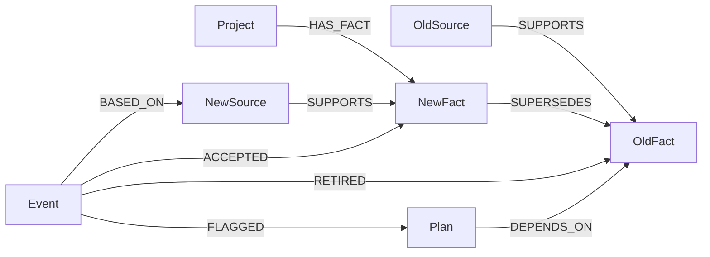
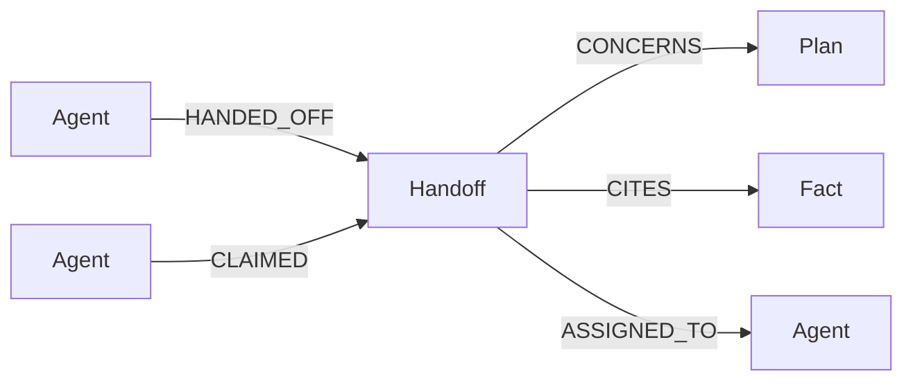

# Implemented graph operations

The authoritative executable queries are in
[src/retract/graph.py](../src/retract/graph.py). This guide explains those methods
so a reviewer can follow the implementation without treating a diagram as proof
of a live database run. Real Cypher compatibility and restart retention remain
verification gates.

## Data and links

Every project-owned node includes `project_id`; fact keys also include `scope`,
`subject`, and `predicate`. Source authority is declared by the local developer
workflow. Update candidates remain event data until the deterministic policy
allows a replacement. Plans depend directly on facts; plan-to-plan propagation
is not implemented.



## Accepted correction

`MemoryService.process_update` validates input and immutable source/event IDs,
looks up the current fact within the exact scoped key, and invokes `policy.decide`.
Only an authoritative, explicitly confirmed change with a matching active target
can reach `GraphStore.record_event` with a new fact. A proposal is recorded as an
event without fact replacement. Existing event IDs return their stored result
only when the request fingerprint matches.

`record_event` performs one guarded write query. It matches the project at the
expected revision, resolves the old active fact and explicitly dependent plans,
then creates source/event links. For an applied update it preserves the old fact
with status `superseded`, creates the new active fact, adds `SUPERSEDES`, `RETIRED`,
and `ACCEPTED`, flags the matched plans, and advances the revision. A zero-row
result is a conflict. This describes the implemented write shape; database
rollback behavior is checked by the opt-in integration suite, not assumed.

## Stored dependency paths

`GraphStore.dependent_paths` uses this query (line wrapping only):

```cypher
MATCH (p:Plan {project_id: $project})-[:DEPENDS_ON]->
      (f:Fact {project_id: $project, id: $fact})
WHERE p.status <> 'superseded'
RETURN p.id, f.id ORDER BY p.id
```

`recall` and the dashboard read the actual update/retirement/dependency path to
explain an affected plan. The dashboard uses this bounded query:

```cypher
MATCH (e:UpdateEvent {project_id: $project})-[:FLAGGED]->
      (p:Plan {project_id: $project}),
      (e)-[:RETIRED]->(f:Fact {project_id: $project})<-[:DEPENDS_ON]-(p)
WHERE p.id IN $plans
RETURN properties(e), properties(p), properties(f)
ORDER BY e.id, p.id, f.id LIMIT 1001
```

A plan can depend on a fact in another scope of the same project. Every endpoint
is project-constrained. No inferred code or text-similarity dependency is added.
The response caps displayed paths at 1,000 and records truncation.

## Current context, history, and evidence

`active` matches only the exact project/scope/key and `status: 'active'`.
`recall` returns current facts, `Source-[:SUPPORTS]->Fact` evidence, affected-plan
warnings, and pending conflicts separately. It never deliberately merges old
facts or unaccepted candidates into the current-facts field.

`history` traverses `SUPERSEDES` in both directions with a 32-edge bound and
requires every node in the path to belong to the selected project. It retrieves
the corresponding replacement links, supporting sources, and recorded events.
An event lookup returns that event's result and source directly.

`dashboard_snapshot` adds bounded active/history/event/plan lists, real counts,
evidence edges, available scopes, and the plan explanation paths above. Its
read-only queries execute while the service lock is held. Request activity is
process metadata and is separate from the authoritative graph state.

## Handoffs between agents

`create_handoff` is one guarded write. It matches the project at the expected
revision and the plan if it is not superseded, collects the cited facts that are
still active, and refuses (zero rows) unless every cited ID matched. It then
creates the handoff and its links:



`claim_handoff` matches `h.status = 'open'` inside the same guarded write, so
concurrent claims have a single winner. On recall, claim, and the dashboard, the
service compares what the sender relied on with the current graph using two
bounded traversals:

```cypher
// Current version of a handed-off plan
MATCH path=(latest:Plan {project_id: $project})-[:REVISES*0..32]->
      (:Plan {project_id: $project, id: $plan})
WHERE latest.status <> 'superseded' AND all(n IN nodes(path) WHERE n.project_id = $project)
RETURN latest.id, latest.status ORDER BY length(path) DESC LIMIT 1

// Active replacement of a cited fact
MATCH path=(latest:Fact {project_id: $project, status: 'active'})-[:SUPERSEDES*0..32]->
      (:Fact {project_id: $project, id: $fact})
WHERE all(n IN nodes(path) WHERE n.project_id = $project)
RETURN latest.id ORDER BY length(path) DESC LIMIT 1
```

A changed result becomes a receiver warning such as "Fact F1 was superseded;
current: F5". `recall` also uses the second traversal to report each affected
plan's dependencies, which the reviewer agent (`src/retract/agent.py`) uses to
decide what to draft and hand off.

## Parameters and limits

All user values go through query parameters. Only trusted internal labels form
query text, and `get` allow-lists them. The application serializes operations in
one process and guards writes by project revision. This is not a distributed
writer guarantee. There is no runtime test-store fallback, semantic retrieval,
autonomous change detection, or unbounded dependency propagation.

Run `python scripts/verify_phase1.py` for actual queries, fault/restart behavior,
and the structured evaluation. See [Phase 5](10-EVALUATION-AND-RELEASE.md) for
metric definitions and reports; tests that use `tests.support.ModelStore` do not
establish these database properties.
